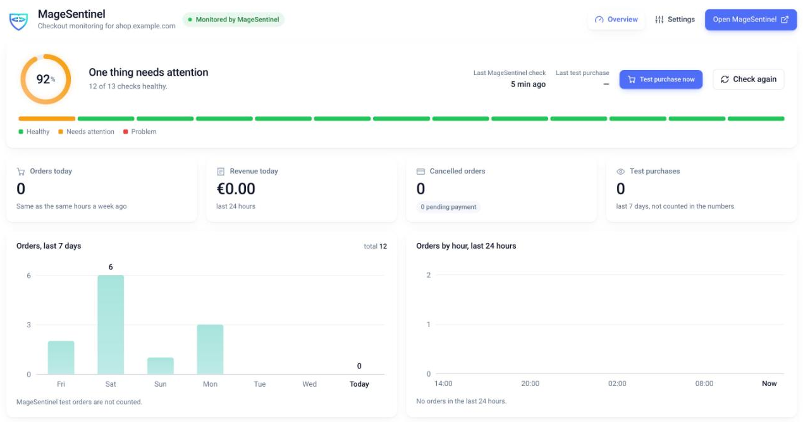
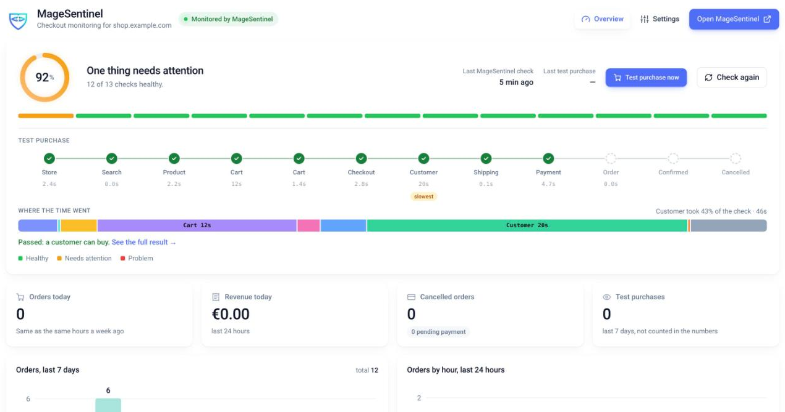
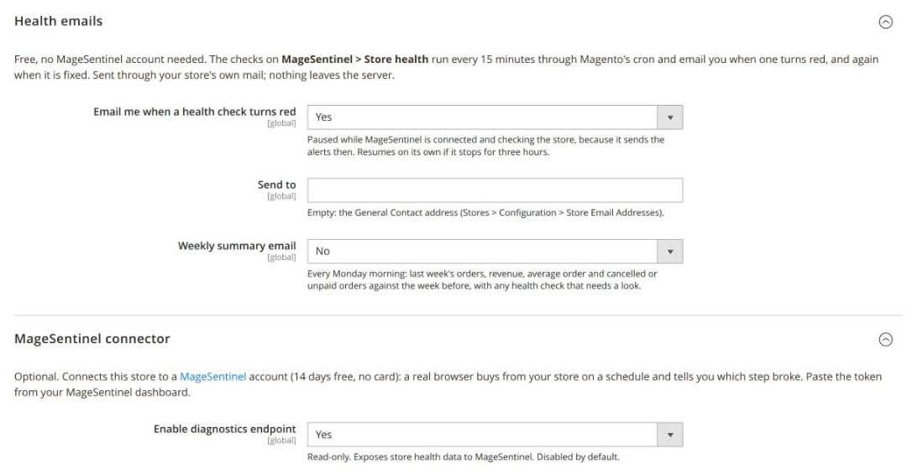

# MageSentinel Monitor for Magento 2

Checkout health for your Magento 2 store, in two parts. The first is free and needs no account.

Made by [MageSentinel](https://magesentinel.com/?utm_source=github&utm_medium=readme), real-browser checkout monitoring for
Magento 2 and WooCommerce. Our [data from 55,000 test purchases](https://magesentinel.com/blog/checkout-failure-report-2026)
shows 77% of checkout failures happen while the store is up, so uptime monitoring never sees them.

| | Free, no account | With a MageSentinel account |
|---|---|---|
| Store health page in the admin | ✓ | ✓ |
| Email when a health check turns red, every 15 minutes | ✓ | alerts by email or Slack |
| Weekly summary email | ✓ | ✓ |
| Real-browser test purchase from the admin | once a month | any time |
| Scheduled test purchases with screenshots and alerts | | every 30 minutes |
| Root-cause data (modules, cron, logs) on a failed check | | ✓ |

## Features

**A health page in your admin.** Under **MageSentinel › Store health** you get a plain reading of the things that quietly
stop a Magento store from taking money, each with a link to the screen that fixes it:

- maintenance mode left on
- no payment method or no shipping method enabled
- orders stopped coming in, compared with the same hours last week
- orders stuck in *pending payment* (a failing card gateway)
- cron not running
- invalid indexers, disabled or stale caches
- fatal error reports in `var/report` in the last 24 hours (counted, never read)
- a module upgrade waiting for `setup:upgrade`
- the HTTPS certificate close to expiry
- developer mode on a live store
- low disk space

**Email alerts, every 15 minutes.** The same checks run through Magento's cron. When one turns red you get an email naming
the problem, and another when it is fixed. One email per problem, not one per run. Sent through your store's own mail.

**A weekly summary** (off until you switch it on): every Monday morning, last week's orders, revenue, average order and
cancelled or unpaid orders against the week before, with any health check that needs a look. MageSentinel's own test
orders are left out.

**Test cart & checkout.** One button opens a real browser on your store, finds a product, adds it to the cart and walks the
checkout to the payment step, the way a shopper does. You watch each step and its time. Without an account it is free once
a month, places no order, and emails the result. On a connected store it runs your MageSentinel monitor right away.

These health checks read settings and counts from the inside. They cannot tell whether a shopper can actually pay (a broken
payment script, a theme update that hides the button). That is what the test purchase is for.

**A connector for MageSentinel** (optional, 14 days free, no card). MageSentinel buys from your store on a schedule and tells
you which step broke, with a screenshot. The connector lets it read why: Magento version and mode, third-party modules,
active payment and shipping methods, cron and indexer state, queue depth, order counts per hour (no order contents), and
the tail of `exception.log`. It is **off by default**: nothing is exposed until an administrator switches it on and sets a
token.

Optional, each behind its own switch, both off by default:

- **Cancel test orders.** MageSentinel cancels the orders its own checks placed: only from a `magesentinel+` address,
  under an hour old, not invoiced, not shipped. Cancels, never deletes.
- **CAPTCHA exemption.** MageSentinel never solves a CAPTCHA. Requests carrying your token can be served without
  reCAPTCHA or Magento's image CAPTCHA; every other visitor still gets it.

## Screenshots

| Store health | Test cart & checkout | Settings |
|---|---|---|
|  |  |  |

## Install

```bash
composer require magesentinel/module-monitor
bin/magento module:enable MageSentinel_Monitor
bin/magento setup:upgrade
bin/magento setup:di:compile   # production mode only
bin/magento cache:flush
```

Or copy this directory to `app/code/MageSentinel/Monitor` and run the same commands.

Requirements: Magento Open Source or Adobe Commerce 2.4.x, PHP 7.4–8.4, a working Magento cron for the emails.

## Set up

1. Open **MageSentinel › Store health**. The health checks work straight away.
2. **Stores › Configuration › MageSentinel › Checkout Monitoring › Health emails**: choose who gets the emails (empty means
   the General Contact address) and switch on the weekly summary if you want it.
3. Optional, to connect MageSentinel: [start a free trial](https://magesentinel.com/signup?utm_source=github&utm_medium=readme),
   add your store, copy the connector token, then under **MageSentinel connector** set *Enable diagnostics endpoint* to
   **Yes** and paste the token.

Check the connector from the command line:

```bash
curl -H "X-MageSentinel-Token: <token>" https://your-store.example.com/rest/V1/magesentinel/diagnostics
```

Without a valid token it answers `401`.

## FAQ

**Does it slow the store down?** No. Nothing runs on storefront requests. The health page runs when you open it, the
checks every 15 minutes in cron, and the diagnostics only when MageSentinel calls them.

**Does it send my data anywhere?** The health page and the emails run entirely on your server. The module contacts
magesentinel.com only when you press *Test cart & checkout*, or when the connector is on and MageSentinel calls it. See
[External services](#external-services).

**Will test orders confuse my staff or reach the warehouse?** The free test never places an order. Scheduled checks on a
connected store place an order only where you allow it, from a `magesentinel+` address, and can cancel it within the hour.

**My checkout has a CAPTCHA.** Switch on *Let MageSentinel's checks past your CAPTCHA*. Only requests carrying your token
skip it.

**Does it work with Hyvä, one-step checkouts, multi-store?** Yes. The health checks are platform-level; the browser test
works on Luma, Hyvä Checkout and the common one-step checkouts. The test uses the default store view's address.

**How do I remove it?** `bin/magento module:disable MageSentinel_Monitor`. Nothing else depends on it.

## External services

The module connects to MageSentinel (https://magesentinel.com) only in these cases:

- **Free test purchase** (store not connected, when you press the button): sends the store's base URL, the alert email,
  your admin language and a one-off random code to `https://magesentinel.com/api/audits/plugin`, then polls for progress.
  MageSentinel reads the code back from `GET /rest/V1/magesentinel/proof` (shown for two minutes at most, nothing else) to
  confirm the request comes from your store. Once a month per store.
- **Test cart & checkout** (connected store, when you press the button): sends the base URL and a SHA-256 hash of your
  token to `https://magesentinel.com/api/connector/checks`. The token itself never leaves the store.
- **Diagnostics** (connector on): MageSentinel calls `GET /rest/V1/magesentinel/diagnostics` with your token. It never
  receives customer names, addresses, emails, payment data, credentials or encryption keys.

Terms: https://magesentinel.com/terms · Privacy: https://magesentinel.com/privacy · DPA: https://magesentinel.com/dpa

## Support

https://magesentinel.com/support · Issues and pull requests welcome on this repository.

## License

MIT
